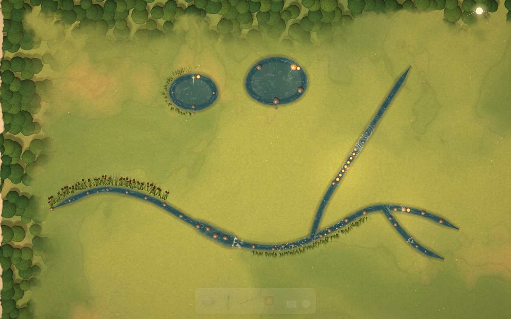
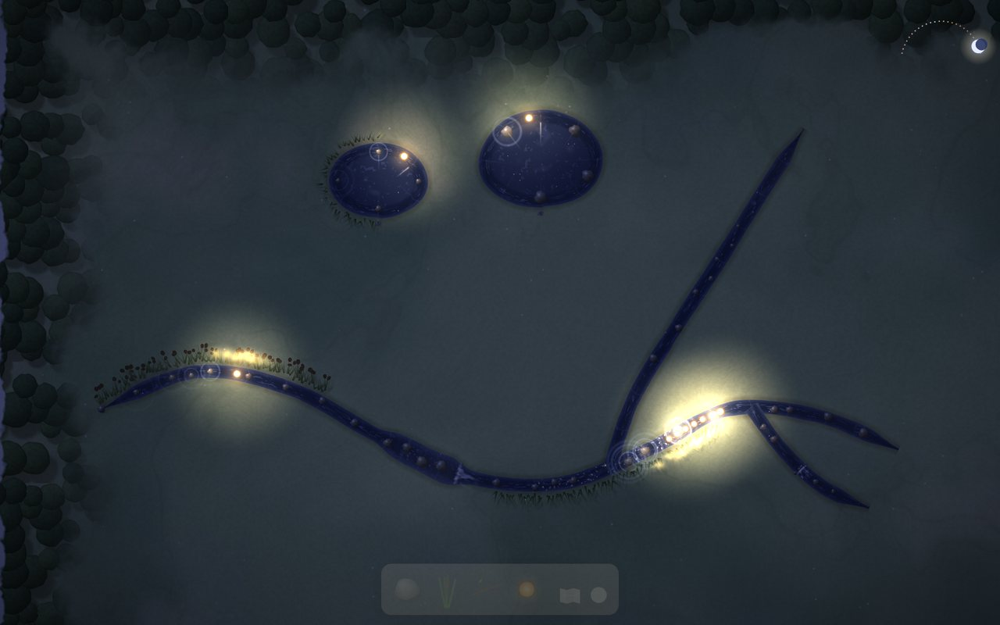
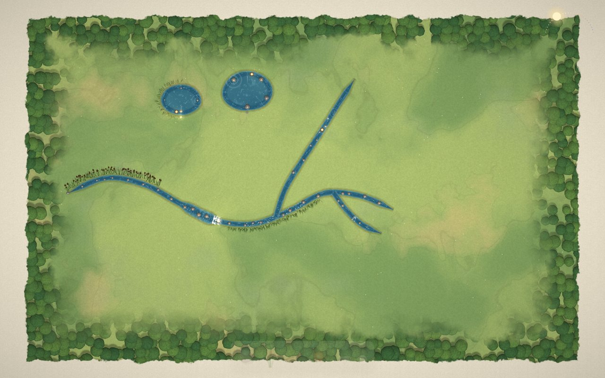

# Riversong

**You don't place notes on a timeline. You draw the timeline.**

Time is a river you sketch across the land, and the music is whatever the water touches on its way. Lanterns ride the water: wherever a lantern is, that is the moment of the song you are hearing. Stones ring, reeds hum, little waterfalls drum, gravel rustles, and zoomed out, the whole song is a painting of a river system.

**Play it:** https://erenciracioglu-dotcom.github.io/Riversong/ (or download `index.html` and double-click it; it works offline, nothing to install).

## How to play

| | |
|---|---|
| **Draw water** | Drag across the land. A lantern rides each stream from start to end, again and again. |
| **Pond** | Lead a stream back into itself. The size of the loop is the length of the phrase: a small pond repeats quickly, a lake unfolds slowly. |
| **Split** | Start drawing on an existing stream. Lanterns take turns left and right, so the tune changes every other time round. |
| **Rub out** | Scribble back and forth over water (or right-drag) and the land closes over it. |
| **Stones** | Take the stone from the tray. Tap water for a pebble; hold and it grows. Bigger always sings lower. Drag it *along* the water for a bed of gravel (a soft rustle), *across* the water for a little waterfall (a deep drum). |
| **Reeds** | Paint along a bank. Reeds are long tones that last as long as the stretch you paint. Hold first for taller, deeper reeds. |
| **Speed** | Pinch a stretch narrow and the water runs twice as fast; widen it into a pool and it drifts at half speed. With a mouse: Shift + scroll over the water. |
| **Lanterns** | Drop a second lantern and the melody chases itself, like singers starting the same tune a moment apart. Drag a lantern onto land to put it out. |
| **Dam** | Lay a twig across a stream: that part falls silent while lanterns gather behind it. Tap the twig to lift it and they pour out together. |
| **Rain** | Press and hold on open land. Each drop plays the stone it lands on. |
| **Light** | Drag the sun (top right) from dawn through dusk to night. The whole valley changes, and every stone and reed retunes with it. |
| **Look around** | Scroll or pinch to zoom, two fingers / right or middle mouse to move. Zoom all the way out to open your **atlas of valleys**. |

Keys: `1`–`4` pick up stone / reed / twig / lantern, `Esc` puts it back, `M` mutes, `0` shows the whole valley, `H` opens the help note, `A` opens the atlas.

Every valley saves itself in your browser. The atlas keeps them all; open one and it is already flowing. *Share link* turns a valley into a URL that carries the whole place.

## Why nothing can sound wrong

* **In tune:** everything plays from one pentatonic set on D. Turning the day only rotates which five notes are used (dawn *ritsu*, morning major, golden hour *suspended*, dusk minor, night *man gong*), so there are no semitone clashes at any time of day.
* **In time:** every stream is a whole number of beats long; everything that sounds settles onto quarter-beat ripple lines; narrowing doubles and widening halves the speed of whole beat cells; lanterns, dams and rain all start on the grid. Two ponds of 6 and 8 beats drift apart and come back together every 24 beats, and you can see it: their start stones light up and a thread of light joins them.
* **Sample-accurate:** lanterns are simulated slightly ahead of the audio clock and every note is scheduled on the Web Audio timeline, so the picture and the sound stay locked together.

## Sounds

Real instruments from the **Versilian Community Sample Library (VCSL)**, released under **CC0**: soft-mallet marimba and vibraphone (stones), a Renaissance organ's wooden 8′ pipes (reeds, looped), concert bass drum and frame drums (waterfalls), a small shaker and cabasa (gravel), an ocean drum and a gong (the dam bursting) and a Nepalese hand bell (a new lantern). The samples were trimmed, tuned (measured to within a few cents) and normalised with `tools/process_samples.py`.

## Under the hood

Plain JavaScript, WebGL 2 and the Web Audio API; no libraries, no server, no network.

* `src/js/20_model.js` water geometry: beats along the water, speed cells, splitting and erasing
* `src/js/30_sim.js` lanterns, forks, dams, and the lookahead scheduler
* `src/js/40_audio.js` sampler voices, looped reeds, a generated valley reverb and a dotted-eighth echo
* `src/js/50_shaders.js`, `55_render.js` painted land, flowing water, ponds, sprites, day and night light
* `src/js/70_input.js` the gestures; `80_ui.js` the tray, the light, the hints; `85_store.js` saving, sharing, the atlas

`index.html` in the root is a single self-contained file built from `src/` with `python tools/build.py`. During development you can open `src/index.html` directly.

## Türkçe

**Riversong**, notaları bir zaman çizelgesine koymak yerine zamanın kendisini çizdiğin bir müzik oyuncağı. Toprağın üzerinde sürükleyerek dere çiz; derede süzülen fener o an duyduğun yerdir. Taşlar çınlar, kamışlar uzun sesler verir, küçük şelaleler davul gibi gümbürder, çakıl hışırdar. Uzaklaşınca bütün şarkı bir nehir sisteminin resmine dönüşür.

* **Su çiz:** toprağın üzerinde sürükle. Dereyi kendine bağlarsan gölet olur; göletin büyüklüğü cümlenin uzunluğudur.
* **Taş:** suya dokun, çakıl; basılı tut, büyür. Büyük taş daha pes söyler. Su boyunca sürükle: çakıl yatağı; karşısına sürükle: şelale.
* **Kamış:** kıyı boyunca boya; boyadığın uzunlukta uzun bir ses.
* **Hız:** suyu sıkıştır, iki kat hızlı aksın; genişlet, yarı hızda süzülsün (fareyle Shift + tekerlek).
* **Çatal, fener, set, yağmur, ışık:** bir dereden kol ayır, fenerler sırayla sağa sola gider; ikinci bir fener bırak, ezgi kendini kovalar; dal koy, fenerler birikir, kaldır, hep birlikte akarlar; açık toprağa basılı tut, yağmur yağar; sağ üstteki güneşi geceye sürükle, her şey yeniden akort olur.
* Her vadi tarayıcında kendiliğinden kaydedilir; en çok uzaklaşınca **Vadiler Atlası** açılır. Dil düğmesi yardım notunda ve atlasta.

## License

Code: MIT (see `LICENSE`). Sounds: VCSL, CC0 1.0. Made with Claude.
